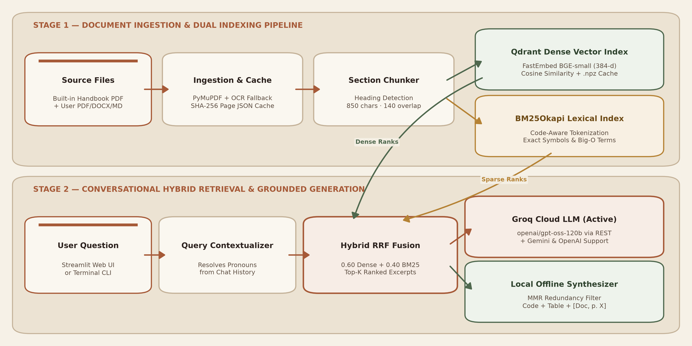
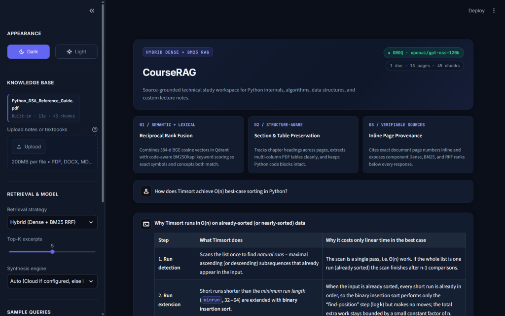
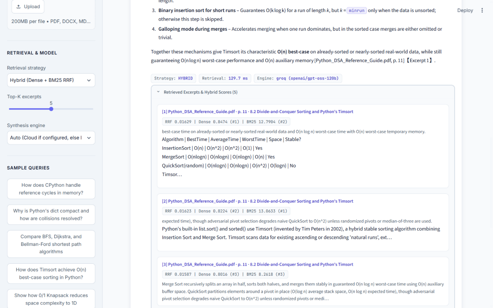

# CourseRAG

CourseRAG is a study assistant built in Python for querying computer science reference guides, lecture notes, and uploaded technical documents. It comes bundled with a 10-chapter **Python Internals & Data Structures Reference Guide** PDF and supports uploading `.pdf`, `.docx`, `.md`, and `.txt` files directly from the browser or terminal.

Most simple PDF chatbots rely purely on vector cosine similarity over fixed character slices, which tends to miss exact code identifiers (`heapq.heapify`, `bisect_left`, `O(n log n)`) and cuts functions or tables in half. CourseRAG addresses both issues by combining **dense embeddings** (`BAAI/bge-small-en-v1.5` via FastEmbed + Qdrant) with **code-aware BM25 lexical scoring** (`BM25Okapi`) fused through **Reciprocal Rank Fusion (RRF)** over section-aware chunks.



---

## Features

- **Hybrid Retrieval (Dense + BM25 with RRF):** Runs semantic vector search and lexical keyword search in parallel and merges ranks (`k = 60`, `0.60` dense / `0.40` BM25), with a sidebar toggle to compare `Hybrid`, `Dense`, and `BM25` modes.
- **Section-Aware Chunking & Table Extraction:** Uses PyMuPDF `find_tables()` to preserve multi-column tables as pipe-delimited rows, tracks chapter/section headings across pages, keeps Python code blocks intact, and falls back to OCR if a scanned PDF page has no text layer.
- **Fast Local Caching:** Parsed pages (JSON) and ONNX embeddings (`.npz`) are cached on disk by file SHA-256 hash so subsequent launches load in milliseconds.
- **Multi-Provider LLM + Offline Fallback:** Connects to **Groq** (`openai/gpt-oss-120b`), **Google Gemini** (`gemini-2.5-flash`), or **OpenAI** (`gpt-4o-mini`) via lightweight `httpx` requests. If no API key is configured, it automatically falls back to a local Maximal Marginal Relevance (MMR) extractive synthesizer with inline `[Document, p. X]` citations.
- **Retrieval Transparency:** Every response includes an expandable **Retrieved Excerpts & Hybrid Scores** panel showing exact page numbers, section titles, dense similarity, BM25 scores, and fused RRF ranks.
- **Dark & Light Mode Switcher:** Built-in one-click toggle between **Midnight Slate (Dark)** and **Daylight Slate (Light)** developer themes.

---

## Interface Preview

**Midnight Slate (Dark Mode)**



<details>
<summary>View Daylight Slate (Light Mode) &amp; Expanded Hybrid Score Inspector</summary>



</details>

---

## Project Structure

```text
CourseRaG/
├── .streamlit/
│   └── config.toml                        # Midnight & Daylight Slate theme defaults
├── data/
│   └── handbooks/
│       └── Python_DSA_Reference_Guide.pdf # Built-in 10-chapter CS & Python study guide
├── docs/
│   └── assets/                            # Architecture schematic and UI screenshots
├── scripts/
│   ├── build_handbook_pdf.py              # Rebuilds the bundled reference PDF from source
│   └── cli.py                             # Interactive & single-query terminal interface
├── src/
│   ├── __init__.py
│   ├── chunking.py                        # Section-aware splitter preserving code blocks
│   ├── config.py                          # Settings dataclass & provider auto-detection
│   ├── generator.py                       # Query contextualizer, cloud REST calls & local MMR
│   ├── ingestion.py                       # PDF/DOCX/MD/TXT loader + table parser + SHA-256 cache
│   ├── pipeline.py                        # CourseRAGPipeline orchestrator
│   └── retriever.py                       # Qdrant dense + BM25Okapi sparse + RRF fusion
├── tests/
│   └── test_pipeline.py                   # Pytest suite covering ingestion, retrieval & synthesis
├── app.py                                 # Streamlit web application
├── pyproject.toml                         # Pytest configuration
├── .env.example                           # Environment variable template
└── requirements.txt                       # Pinned Python dependencies
```

---

## Local Setup

### 1. Clone the repository

```bash
git clone https://github.com/Katsu6969/CourseRaG.git
cd CourseRaG
```

### 2. Create a virtual environment and install dependencies

**Windows (PowerShell):**

```powershell
python -m venv .venv
.\.venv\Scripts\Activate.ps1
pip install -r requirements.txt
```

**macOS / Linux:**

```bash
python3 -m venv .venv
source .venv/bin/activate
pip install -r requirements.txt
```

*(On the first run, `fastembed` downloads the ~130 MB `BAAI/bge-small-en-v1.5` ONNX model locally—no Hugging Face token required.)*

### 3. Configure API key (optional)

CourseRAG works offline out of the box in local extractive mode. To enable cloud LLM responses via Groq (recommended), Gemini, or OpenAI, copy `.env.example` to `.env` and add your key:

```bash
cp .env.example .env
```

```env
LLM_PROVIDER=groq
GROQ_API_KEY=your_groq_key_here
GROQ_MODEL=openai/gpt-oss-120b
```

You can also paste an API key directly in the Streamlit sidebar at runtime.

---

## Usage

### Streamlit Web App

```bash
streamlit run app.py
```

Open `http://localhost:8501` to ask questions, upload extra study materials, switch retrieval modes, and inspect source scores.

### Command-Line Interface

```bash
# Interactive mode
python -m scripts.cli --show-sources

# Single query from terminal
python -m scripts.cli -q "How does Timsort achieve O(n) best-case sorting in Python?" --mode hybrid --show-sources

# Query an additional local PDF or Markdown file
python -m scripts.cli -f path/to/notes.pdf -q "Summarize the main algorithm"
```

---

## Deploying on Streamlit Community Cloud

Because GitHub Pages only hosts static HTML/JS sites, deploy the Python backend directly from this repository using **Streamlit Community Cloud** (free):

1. Go to [share.streamlit.io](https://share.streamlit.io/) and sign in with GitHub.
2. Click **Create app** and select `Katsu6969/CourseRaG`, branch `main`, main file path `app.py`.
3. Open **Advanced settings -> Secrets** and add:
   ```toml
   LLM_PROVIDER = "groq"
   GROQ_API_KEY = "your_groq_key_here"
   GROQ_MODEL = "openai/gpt-oss-120b"
   ```
4. Click **Deploy**.

---

## Running Tests

```bash
pytest -v
```

The test suite verifies PDF/DOCX/Markdown parsing, SHA-256 cache reuse, section-aware chunking, Dense vs. BM25 vs. Hybrid RRF retrieval, follow-up pronoun contextualization, dynamic file uploads/removals, and off-topic query handling.
